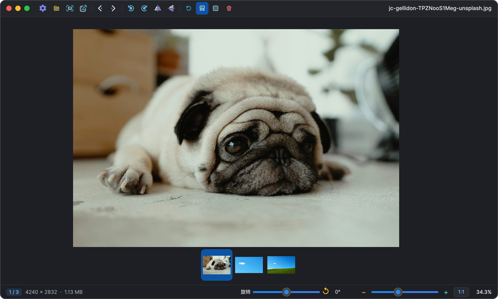
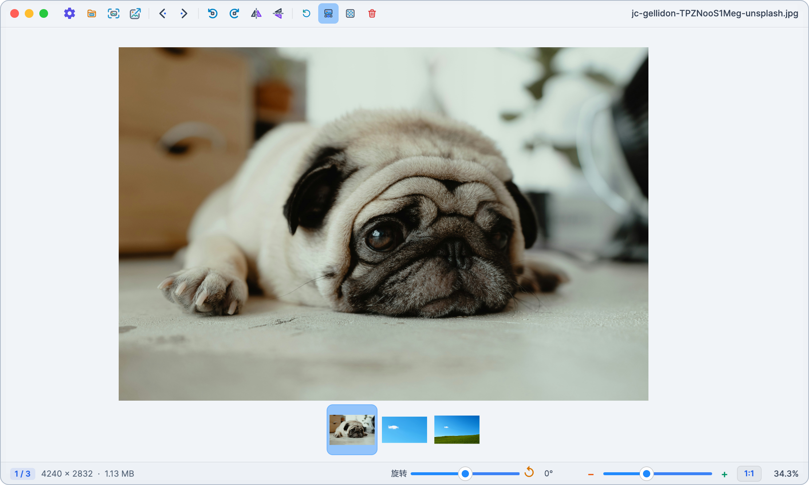
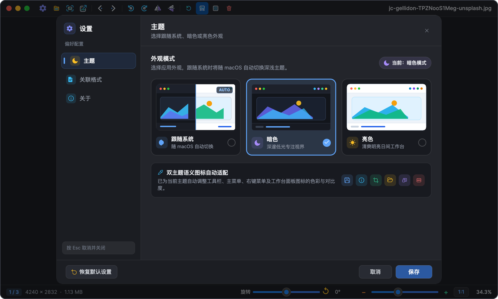
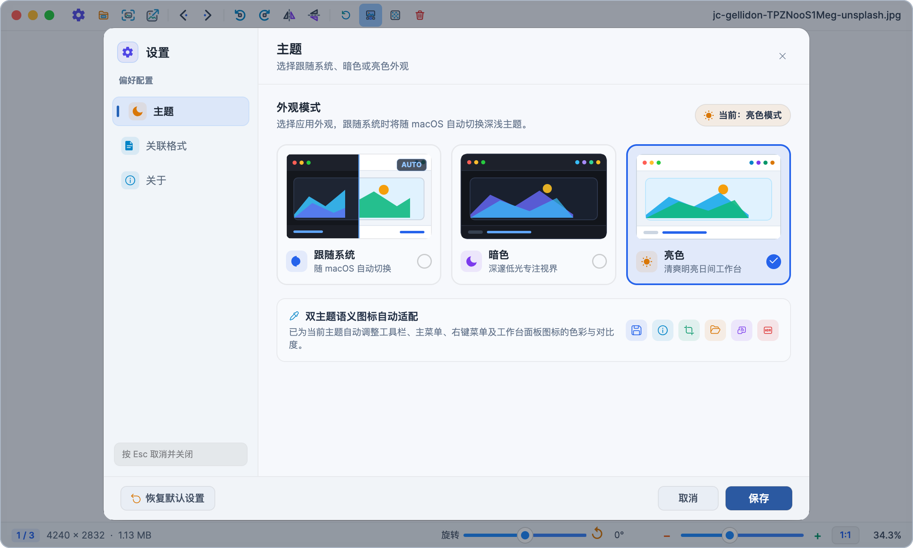

<div align="center">

# ChuImage

### 轻盈、顺手的桌面图片查看器

[](https://image.withqq.com)
[](#平台支持)

</div>

ChuImage 是一款面向桌面用户的图片查看器，支持图片浏览、缩放、旋转、平移、缩略图浏览和多窗口查看。项目持续完善跨平台体验与界面交互。

## 项目来源与致谢

ChuImage 基于 [ImageGlass](https://github.com/d2phap/ImageGlass) 开源项目进行二次开发。感谢 ImageGlass 原作者 **Duong Dieu Phap** 及所有贡献者提供优秀的代码基础和持续维护，也感谢开源社区提供的反馈与帮助。

ChuImage 是独立的衍生项目，并非 ImageGlass 官方发行版。上游项目的版权和许可声明保留在相应源码文件中。

## 功能

- 浏览图片并在同一文件夹中切换
- 鼠标拖动平移图片，支持惯性移动
- 缩放、连续旋转、翻转和视图重置
- 浏览底部缩略图并切换图片
- 为不同图片打开独立窗口
- 切换跟随系统、浅色和深色主题
- 支持拖放打开图片、棋盘透明背景和常用快捷键
- 展示图片尺寸、文件大小等信息

可打开的具体格式取决于内置编解码器及系统支持。项目以共享核心代码提供 Windows、macOS 和 Linux 客户端。

## 界面预览

**主窗口**

<p align="center">
  
  
</p>

**主题设置**

<p align="center">
  
  
</p>

## 获取 ChuImage

访问 [image.withqq.com](https://image.withqq.com) 查看项目介绍和可用版本。

## 平台支持

| 平台 | 当前构建目标 |
| --- | --- |
| Windows | x64、ARM64 |
| macOS | Apple Silicon（ARM64） |
| Linux | x64 |

## 从源码构建

项目使用 C#、.NET 11 和 Avalonia UI。构建需要 .NET 11 SDK（当前源码使用预览版 C# 功能）以及对应平台的原生构建工具；macOS 需要 Xcode Command Line Tools。

先还原依赖：

```sh
dotnet restore source/ImageGlass.slnx
```

在仓库根目录发布对应平台：

```sh
# Windows x64
dotnet publish source/ImageGlass.Win32/ImageGlass.Win32.csproj -c Release -p:Platform=x64

# Windows ARM64
dotnet publish source/ImageGlass.Win32/ImageGlass.Win32.csproj -c Release -p:Platform=ARM64

# macOS Apple Silicon
dotnet publish source/ImageGlass.Mac/ImageGlass.Mac.csproj -c Release -r osx-arm64 -p:Platform=ARM64

# Linux x64
dotnet publish source/ImageGlass.Linux/ImageGlass.Linux.csproj -c Release -r linux-x64 -p:Platform=x64
```

发布 macOS 应用包时，在完成 macOS ARM64 发布后运行：

```sh
bash source/__assets/mac/script-pack-mac-arm64-app.sh
```

详细构建流程和项目约定见 [`source/CLAUDE.md`](source/CLAUDE.md)。

## 参与贡献

欢迎通过 Issue 反馈问题、提出建议或提交 Pull Request。提交代码时请保留已有的上游版权与许可声明，并为新增依赖遵守其各自的许可证要求。

## 许可

本仓库的源码许可和版权说明以根目录 [`LICENSE`](LICENSE) 及各源码文件中的声明为准。第三方组件仍受各自许可证约束。

---

由 **puppy** 维护 · [项目官网](https://image.withqq.com)
